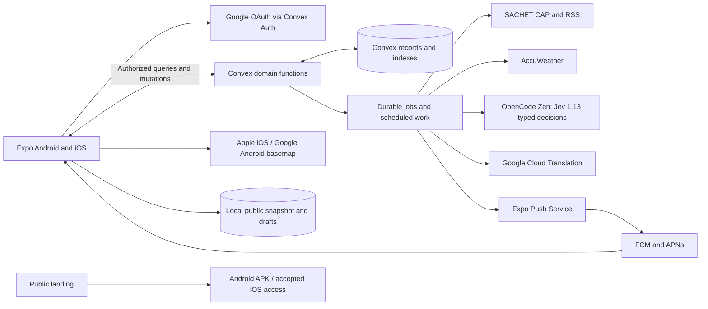

> User override — 2026-10-10: nearby community chat is now authorized without moderation, reports, appeals or restriction queues. First delivery is a live plain-text community stream using public aliases, fixed private message origins, exact 15 km radius, fresh India GPS and 24-hour expiry. Existing burst/hour limits remain. Authority announcements/incident cards and alias mute are follow-ups, not part of this community chat delivery. Chat has no automatic incident/evidence effects. Navigation now includes implemented Chat and SACHET, with icon-only controls and accessible labels (latest user override).

> Implementation status: [docs/current-state.md](docs/current-state.md) distinguishes implemented functionality, acceptance gaps and deferred scope. This document includes planned features and is not proof they are complete.

> Assessment cadence override — 2026-10-10: periodic Jev reassessment is now hourly (60 minutes). New/updated observations still queue immediately; outage retries remain 1/5/15 minutes.

> Reporting clarification — 2026-10-10: normal Report incident records a personal COMMUNITY observation for every account, including authorities. It never grants official verification from account membership. Official publication is an explicit authority-workspace action with audience and jurisdiction authorization.

> Shelter override — 2026-10-10: user explicitly requested raw nearest listed shelter by straight-line distance, without eligibility filtering. Preserve visible status, age, source, DEMO attribution and official instructions. Older suitable-shelter selection/exclusion requirements below are superseded for the current implementation. DEMO shelters appear only with explicit DEMO opt-in.

> Latest notification scope (2026-10-10): user requested in-app custom notifications only. When an emergency is published, queued geographic targeting updates eligible accounts and Convex real-time subscriptions present a global popup in open foreground clients. Native notification permission, APNs/FCM/Expo push and closed-app delivery are deferred. Other core incident, authority, translation and location requirements remain unchanged.

# GudTour — detailed technical implementation plan

Date: 2026-10-10. Revision: 3. Status: design specification with dated implementation checkpoints; incomplete workflows remain planned.

## 1. Authority of this document

This document translates [PLAN.md](PLAN.md) into an engineering design using the decisions in [tech-stack.md](tech-stack.md). [TODO.md](TODO.md) is the execution backlog. The organizer brief controls eligibility and submission; latest explicit user decisions control product scope; PLAN.md controls behavior; this document specifies mechanisms. Conflicts are resolved in that order, not by silently adopting older research.

Confirmed: Expo Android/iOS, Convex, Google OAuth, Apple basemap on iOS, Google basemap on Android, AccuWeather, NDMA SACHET CAP/RSS, TypeSafe Jev through OpenCode Zen, Google Cloud Translation, six languages, India-only entry, optional background location, nearby chat, automatic Jev escalation, online-first operation. News and downloadable offline basemaps are removed from the initial scope. Minimal cached reading and unsent drafts remain.

The app supports both an app-assessed community emergency and an official emergency. A model outcome cannot become official verification. Verification, emergency status, severity, source and freshness are distinct throughout storage, API and UI.

### Core-plan traceability

| Core requirement in PLAN.md | Engineering design | TODO coverage |
| --- | --- | --- |
| Approved authority identity and tourist privacy, sections 2–3 | Sections 6–9, 18, 21–22 | F/L/R tasks |
| Map, reporting, recent independent witnesses, sections 4–7 | Sections 5, 8–10, 18 | I tasks |
| Evidence-based automatic Jev qualification, section 8 | Sections 11–13, 23–24 | E tasks and P07 |
| Official source freshness and authority bypass, sections 9/14 | Sections 11, 14, 18, 23 | E/A tasks |
| Per-user geographic emergency alerts and updates, section 10 | Sections 8, 14, 17 | N tasks |
| Suitable listed shelter and instruction precedence, section 11 | Sections 15–16 | A/N tasks |
| Meaning-preserving translation and original attribution, section 12 | Section 16 | N01–N03 |
| Complete tourist/authority screens, sections 13–14 | Sections 9, 18 | B/D-owned I/A/N tasks |
| Nearby chat, reporting and appeals, section 15 | Section 19 | C tasks |
| Privacy, retention and acceptance, sections 17–18 | Sections 20–24 | R/Q tasks |
| Latest online-first override of section 16 | Section 20; cached reads and explicit unsent drafts | R01–R04 |

This mapping preserves the core idea rather than substituting a generic AI chat app. Original news/full-offline proposals are the explicit user-directed changes; role-based crisis communication, evidence timing, targeting, translations, shelters and nearby chat remain in scope.

Development is authorized and underway on 2026-10-10 in the GitHub-connected bitsnbytes folder. Expo/native foundations, core Convex identity/privacy/authority handlers, iOS Google sign-in/India admission/private profile and Apple Maps rendering are implemented. Atomic observation submission, hazard timers and separate verification/lifecycle/qualification are implemented with backend tests. The complete incident, emergency, shelter, chat and release workflows remain pending. Current task evidence is in TODO.md and docs/progress/2026-10-10-development.md.

Google OAuth, restricted Android Maps and Translation v2 credentials are configured in the existing GCP project; backend-only credentials are set on Denoise Labs Convex development. AccuWeather location/current/24-hour history, Jev Choice, Translation and SACHET RSS/CAP ETag requests passed live connectivity checks. Quota/license review, decision evaluation, Android rendering, push/signing and full application acceptance remain open. Credentials live only in ignored/private configuration; see docs/api-setup.md.

## 2. System architecture



The mobile app requests domain operations, not arbitrary provider calls. Convex queries return authorized read models; mutations apply atomic state changes; actions call external services and commit results through internal mutations. Node-dependent integrations live in separate action modules. This matches the documented Convex function boundary. [Convex actions](https://docs.convex.dev/functions/actions)

Convex is the only canonical application database. No PostgreSQL, Supabase, NextAuth server, FastAPI service or VPS is part of this design. GCP supplies Google identity configuration, Android Maps and Translation; local gcloud authentication is not inherited by deployed Convex.

External operations are asynchronous. Publishing succeeds when the incident/alert and durable expansion job are committed, not when all phones have received messages. The app independently shows persistent in-app alerts even if push delivery fails.

## 3. Proposed repository and module ownership

The tree is a design, not existing application source. Keep one root Expo application to avoid unnecessary monorepo packaging during the hackathon; deploy the static landing separately.

```text
src/app/
  _layout.tsx
  (entry)/                 language, location gate, login, onboarding
  (tourist)/(tabs)/        map, incidents, shelters, chat, settings
  (tourist)/incident/[id].tsx
  (tourist)/shelter/[id].tsx
  (tourist)/alerts/        active, history, detail
  (tourist)/report.tsx
  (authority)/            overview, incidents, publish, shelters, contacts, moderation
src/
  components/             shared native controls and status presentation
  features/               entry, incidents, shelters, alerts, chat, authority, settings
  domain/                 policy, state transitions, pure geography/time helpers
  contracts/              shared DTOs and error enums
  services/               location, notification handling, local cache, deep links
  i18n/locales/           en, hi, ta, fr, de, es
  theme/                  tokens and platform semantics
convex/
  schema.ts               all app records/indexes plus Convex Auth tables
  auth.ts, auth.config.ts, http.ts
  lib/                    authorization, validation, geography, policy, idempotency
  profiles.ts, locations.ts, devices.ts
  incidents.ts, observations.ts, alerts.ts
  shelters.ts, contacts.ts, chat.ts, moderation.ts
  authority.ts            authority command entry points
  jobs.ts                 claims, leases, checkpoints, job completion
  assessments.ts, sources.ts, translations.ts
  integrations/           sachet, accuweather, jev, googleTranslation, expoPush
  workers/                ingestion, assessment, targeting, delivery, retention
  crons.ts
tests/                    domain, Convex integration and mobile interaction tests
landing/                  small public static site
docs/                     contracts, evidence, deployment and dated progress
app.config.ts, eas.json, package.json, lockfile, .env.example
```

Owner A controls schema, shared interfaces, dependencies, auth and integration. B owns tourist screens/location/cache. C owns provider adapters and evidence/alert workers. D owns authority screens, moderation presentation, independent verification and release. Workers depend on agreed A-owned commands and DTOs; they do not independently redesign tables. The four-person allocation is a responsibility model, not a request to launch agents.

## 4. Engineering conventions and invariants

- Store timestamps as UTC epoch milliseconds; preserve the raw official timestamp/timezone separately. Display local time with an explicit zone for deadlines.
- Distinguish observedAt, receivedAt, issuedAt, fetchedAt and evaluatedAt. An old observation uploaded today never becomes a fresh witness.
- Use Convex document IDs end-to-end. Each editable domain aggregate has an integer revision. Commands carry expectedRevision when overwriting existing state.
- All commands derive user ID/authority membership from authenticated context. A user ID supplied in an argument is never the actor.
- Coordinates use WGS84. JSON geometry arrays use longitude/latitude. CAP latitude/longitude pairs are converted explicitly; radii are metres internally.
- Missing data is null/unknown with a reason, never a zero measurement, an empty checked source, or a safe state.
- DEMO is a stored data classification, not merely a UI ribbon. Demo incidents target only demo-enabled identities and devices.
- Public DTOs are constructed from explicit allowlists. No raw document spreading of private profiles, observations, location indexes or provider payloads.
- An action result is accepted only against its original incident revision, evidence generation, policy version and authority-control revision. Otherwise it is recorded as superseded and the latest context is queued.
- Source endings are independent. One cancelled CAP notice cannot end another authority declaration or community emergency for the same incident.
- No mutation or retry claims exactly-once delivery to a phone. We enforce exactly one logical delivery job per key; network-side duplication is mitigated separately.

## 5. Policy configuration

Create immutable versioned policy records; include policyVersion in assessments, area selection and alert revisions. Changes affect future evaluations and require audit. Do not change parameters merely to force the demo to qualify.

| Hazard enum | Approximate radius | Recent witness window | Non-emergency stale timer |
| --- | --- | --- | --- |
| FLASH_FLOOD | 5,000 m | 60 min | 2 h |
| FLOOD_WATERLOGGING | 5,000 m | 2 h | 6 h |
| LANDSLIDE | 1,000 m | 60 min | 6 h |
| CYCLONE | 25,000 m | 6 h | 24 h |
| SEVERE_STORM | 10,000 m | 2 h | 6 h |
| COASTAL_SURGE | 5,000 m | 2 h | 6 h |
| HEATWAVE | 10,000 m | 6 h | 24 h |
| OTHER_NATURAL | 2,000 m | 60 min | 2 h |

| Rule | Required default |
| --- | --- |
| Entry/report/corroboration fix | Age <=5 min; accuracy <=200 m |
| Chat fix | Age <=5 min; accuracy <=500 m |
| Alert location | Age <=30 min; accuracy <=1,000 m; India; uncertainty overlap counts |
| Stale-location presentation | Older than 15 min |
| Personalized shelter position | Refresh required if older than 15 min |
| Duplicate suggestions | Active, same type, recent <=24 h, <=1 km; cyclone <=10 km |
| Corroboration proximity | <=1 km of eligible observation; official area inclusion also qualifies |
| Incident submissions | No application rate limit (user override 2026-10-10) |
| Witness update cooldown | None; immediate updates retain one witness per person |
| Community corroborated label | At least two distinct recent qualifying witnesses |
| Jev qualification | Selected NOTIFIABLE_EMERGENCY; selected-option probability >=0.90 |
| Candidate reassessment | Five-minute target plus material evidence events |
| Assessment outage retry | 1, 5, 15 minutes, then every 15 minutes |
| Official feed polling | Two-minute target |
| Weather/source freshness | Weather stale >30 min; feed last success stale >10 min |
| Authority suppression | 30-min default; maximum 2 h; reason required |
| Authority incident review | Non-emergency 6-h default/24-h max; emergency 1-h default/24-h max |
| Eligible shelter | Open reconfirmed <=2 h; <=50 km; not full; no conflicting restriction/hazard |
| Chat | Origin radius 15 km; 500 characters; visibility 24 h |
| Tourist chat limit | Five per rolling minute and 30 per rolling hour |
| Urgent repeat | Ten-minute incident cooldown; new Critical instruction exception |
| Exposure re-entry | <=30 min silent; later re-entry may sound |
| Retention | Latest location 24 h inactivity; alerts 30 d; incident history 12 months |

These are prototype product policies from PLAN.md, not validated meteorological or clinical thresholds. New engineering defaults below (payload caps, batches, lease lengths and display uncertainty) are proposed initial settings to test and tune; they do not modify the emergency cutoff.

## 6. Data model and indexes

All tables use explicit validators. Optional values retain unknown semantics. Indexes accelerate queries but are not assumed to enforce uniqueness: check unique keys in the same mutation that inserts them. Store large bounded source documents separately from frequently subscribed summaries. [Convex schemas](https://docs.convex.dev/database/schemas)

### 6.1 Identity and location

| Table | Principal fields | Indexes / constraints |
| --- | --- | --- |
| users/auth tables | Convex Auth identity/session records | Use library schema; no custom password store |
| profiles | userId, name, alias, language, onboardingCompletedAt, optional bloodGroup/emergencyContact, stepFreeNeeded, demoEnabled, revision | by_user; one profile/user; private |
| agencies | name, sourceLabel, active, demo | by_active |
| jurisdictions | agencyId, name, geometryId, coverageVersion, active | by_agency |
| authorityMemberships | userId, agencyId, jurisdictionIds, status, approvedBy, approvedAt, revokedAt | by_user_status, by_agency; operator-managed |
| locations | userId, point, observedAt, receivedAt, accuracyM, countryStatus, foregroundPermission, backgroundPermission, source, revision | by_user, by_country_observedAt; one latest/user |
| devices | userId, installationId, platform, expoToken, permissionState, active, lastSeenAt, appBuild, demoEnabled | by_user_active, by_installation; token ownership checked |
| restrictions | userId, scope, startsAt, endsAt, reason, authorityId | by_user_scope_endsAt |

Only internal targeting jobs can read other tourists' latest positions and device tokens. Authority membership does not grant that read access. On account change, the installation's old association is removed before registration under the new user.

### 6.2 Incidents and evidence

| Table | Principal fields | Indexes / constraints |
| --- | --- | --- |
| incidents | hazard, locality, geometryId, provenance, verification, lifecycle, emergencySummary, authoritativeSeverity?, lastObservedAt, staleAt, reviewDueAt?, mergedInto?, revision, evidenceGeneration, controlRevision, nextAssessmentAt, demo | by_lifecycle_nextAssessmentAt, by_hazard_lastObservedAt, by_mergedInto |
| incidentVersions | incidentId, revision, snapshot, changedBy, actorKind, reason, createdAt | by_incident_revision; immutable snapshots |
| observations | incidentId, authorId?, alias, capturedPoint, fixObservedAt, accuracyM, observedAt, receivedAt, description, status, revision, lastContributionAt, provenance | by_incident_author, by_incident_status_observedAt, by_author_receivedAt |
| observationEvents | observationId, old/new status, correction, actorId?, reason, createdAt | by_observation_createdAt; bounded historical events |
| incidentFlags | incidentId, userId, reason, status, createdAt | by_incident_status; deduplicate reporter/flag category |
| sourceLinks | incidentId, noticeId, relation, establishedBy, createdAt | by_incident, by_notice |
| evidenceSnapshots | incidentId, incidentRevision, evidenceGeneration, controlRevision, policyVersion, canonicalHash, bounded observation/source/weather/history summaries, missingInputs, createdAt | by_incident_createdAt, by_hash; private |
| assessments | incidentId, snapshotId, modelRequested/modelResolved, judgments, qualification, optionProbability, confidence, severityCandidate/confidence, usage, latencyMs, outcomeStatus, evaluatedAt | by_incident_evaluatedAt, by_snapshot |
| suppressionRules | incidentId, authorityId, reason, endsAt, reviewFlag, controlRevision | by_incident, by_endsAt |

The public hazard point may be derived from the report, but it must not be labeled as a live observer position. Exact witness points and identities stay internal. History includes separate provenance/verification; unverified historical incidents are not counted as confirmed susceptibility evidence.

### 6.3 Source and translation records

| Table | Principal fields | Indexes / constraints |
| --- | --- | --- |
| feedSources | approved URL/host, state coverage, enabled, lastAttemptAt, lastSuccessAt, etag/lastModified, failureCount, nextPollAt | by_enabled_nextPollAt |
| officialNotices | sender, identifier, sentAt, reference keys, currentRevisionId, sourceId, classification, demo | by_sender_identifier_sentAt, by_source |
| officialNoticeRevisions | noticeId, payloadHash, CAP fields, geometryId, rawOriginal, sourceLanguage, providedTranslations, issued/effective/expiry, status, msgType, scope, fetchedAt, validationState | by_notice_createdAt; original immutable |
| weatherSnapshots | providerLocationKey, observationAt, fetchedAt, bounded current/history, geographicResolution, availability, expiryAt | by_locationKey_observationAt, by_expiryAt |
| translations | contentKind/contentId, sourceRevision, originalHash, sourceLanguage, targetLanguage, provider, text, status, approvedBy?, createdAt | by_content_revision_language, by_originalHash_language |
| geometries | type, normalized coordinates/radius, boundingBox, source, sourceAccuracy, version, geometryHash | by_hash; validated and bounded |

Do not preserve a full weather provider payload indefinitely by default. Configure storage/expiry after entitlement and terms review. Keep source availability and evidence summaries sufficient to explain decisions within allowed retention.

### 6.4 Alerts, jobs and geographic candidates

| Table | Principal fields | Indexes / constraints |
| --- | --- | --- |
| alerts | canonicalIncidentId, lifecycle, currentRevision, sourceSummary, createdAt | by_incident, by_lifecycle |
| alertSources | alertId, sourceKind, authorityDeclarationId/noticeId/assessmentId, active, originalContentId, geometryId, endedAt/reason | by_alert_active, by_externalSource |
| authorityDeclarations | incidentId, membershipId, geometryId, severity, instructionVersionId, reviewDueAt, active, endedAt/reason, revision | by_incident_active, by_reviewDueAt |
| instructionVersions | sourceKind/sourceId, revision, originalText, sourceLanguage, originalHash, actionKind, namedShelterId?, issuedAt, effectiveAt?, originalDeadline?, approvedBy? | by_source_revision; immutable originals |
| alertRevisions | alertId, revision, currentSources, instruction refs, geometry refs, severity, materialReason, urgency, publishedAt, policyVersion | by_alert_revision; immutable |
| exposures | userId, canonicalIncidentId, alertId, relevant, proximityKind, locationRevision, lastEnteredAt/leftAt, soundEpoch, dismissedRevision, latestSeenRevision, lastSoundAt | by_user_relevant, by_user_incident |
| userAlerts | userId, alertId, revision, eligibilityReason, snapshotLocationAge/accuracy, firstRelevantAt, openedAt?, endedAt? | by_user_createdAt, by_user_alert_revision |
| jobs | kind, key, status, dueAt, leaseToken/leaseUntil, attempt, cursor/checkpoint, payloadRef, lastErrorCode, createdAt | by_key, by_status_dueAt, by_leaseUntil |
| deliveryJobs | userId, deviceId, alertId, revision, kind, soundEpoch, dedupeKey, status, expiresAt, dueAt, attempt, ticketId?, receiptStatus?, lease fields | by_key, by_status_dueAt, by_ticketId |
| deliveryAttempts | deliveryJobId, attempt, started/completedAt, resultCode, ticketId?, uncertain | by_job_attempt; no token values in diagnostics |
| geoPoints | kind, entityId, precision, cell, point, active, observedAt? | by_kind_precision_cell_active; latest user index private |
| areaCoverage | geometryId, precision, cell, entityKind/entityId, revision | by_precision_cell_kind; conservative coverage |
| commandKeys | userId, commandKind, clientRequestId, payloadHash, resultRef, createdAt | by_user_kind_key; expired only after retry horizon |
| rateEvents | userId, operation, scopeId?, acceptedAt, commandKey | by_user_operation_acceptedAt |
| auditEvents | actorId?, actorKind, organizationId?, objectKind/id/revision, action, reason, createdAt | by_object_createdAt, by_organization_createdAt |

### 6.5 Shelter, contact and chat records

| Table | Principal fields | Indexes / constraints |
| --- | --- | --- |
| shelters | jurisdictionId, agencyId, name, point, address, status, statusConfirmedAt, capacity/remaining?, accessibility, facilities, phone, accessInstruction, revision, archivedAt?, demo | by_jurisdiction_status, by_statusConfirmedAt; geoPoints link |
| contacts | jurisdictionId, agencyId, name, purpose, phone, level, source, confirmedAt, revision, archivedAt? | by_jurisdiction_level |
| chatMessages | authorId?, alias, authorityMembershipId?, privateOrigin, locality, body, incidentRef?, publishedAt, expiresAt, visibility, revision, demo | by_expiresAt, by_author_publishedAt; geoPoints link |
| chatReports | messageId, reporterId, reason, status, createdAt | by_message_reporter, by_status_createdAt |
| moderationActions | objectKind/id, authorityId, reason, action, restrictionId?, createdAt | by_object_createdAt |
| appeals | userId, moderationActionId, status, text, resolvedAt?, deleteAfter? | by_action_user, by_status_createdAt |

Notifications and published incidents must not embed optional health/contact data. Moderation evidence is private. Local alias muting does not suppress official alerts.

## 7. Authentication, authorization and entry gate

### 7.1 Google login

Use Convex Auth's Google provider and a system-browser OAuth flow. Configure the backend callback `https://<deployment>.convex.site/api/auth/callback/google`, exact app redirect allowlist, app scheme and development/production clients. Store OAuth client secret in Convex, sessions in SecureStore. Prove callback/refresh/restore on real development builds before feature expansion. [Convex Google OAuth](https://labs.convex.dev/auth/config/oauth/google)

Startup routing: choose/restore language → establish mandatory location/country gate → restore or perform sign-in → complete missing profile → permissions explanation → role-derived home. A revoked authority can retain tourist access but cannot invoke authority commands. Operator provisioning is a protected internal/admin workflow, not a third public role selector.

Sign-out unregisters the device association, stops background tracking, clears local session/private profile/drafts and routes to entry. If offline, local sign-out happens immediately and the server association is revoked on next authenticated maintenance; short delivery TTL and token/session eligibility limit stale sends. Do not claim immediate remote revocation without a successful backend acknowledgment.

### 7.2 Shared backend guards

Design `requireUser`, `requireIndiaAccess`, `requireEligibleFix`, `requireAuthorityForGeometry`, `requireExpectedRevision`, `requireNotRestricted` and `requireDemoCompatibility` as shared helpers. Every public function chooses explicit guards. Workers are internal functions, not public unauthenticated actions protected by a guessable string.

Authority jurisdiction checks intersect/contain the intended affected area as appropriate; an authority cannot enlarge an area outside its assigned jurisdiction by changing a radius. Overlapping authorities can act, with separately attributed instructions and conflict flags. Revocation is checked at command execution and before delayed privileged job application.

### 7.3 India location rule

Use a versioned, licensed India boundary dataset, selected and recorded before implementation. A bounding box alone is insufficient. Entry requires a recent accurate fix whose uncertainty area is clearly inside the supported boundary. Border uncertainty produces a blocking retry state. The client can run the same pure check for immediate presentation; the server recomputes the check for authenticated commands.

GPS evidence is device-reported and spoofable; this design provides consistent eligibility, not proof of physical presence. Clamp impossible coordinates/accuracy/time values, reject future fix timestamps beyond a small documented clock-skew tolerance, and use receivedAt to detect replay. Future event observedAt remains invalid; never silently rewrite it to now.

Temporary position failure after successful entry permits aged viewing based on the last accepted Indian location. New submissions need their operation-specific fix. A fresh outside-India update blocks content/posting and new targeting. Profile/privacy/help/sign-out remain reachable so country gating cannot trap data deletion.

## 8. Geographic indexing and exact matching

Use two geohash precisions initially: a coarse level for broad viewport/area candidate queries and a finer level for points/chat. Store cell-to-point and cell-to-area references with their source revision. Choose actual precisions using India latitude-range tests; precision 4/5 is a starting benchmark, not a fixed physical-size claim.

Procedure: normalize geometry → conservative bounding box/cover → enumerate intersecting cells, including neighbors needed by uncertainty → fetch bounded candidate pages → deduplicate entity IDs → apply exact geodesic/geometry predicate. Circles use `distance <= radius + accuracy`; polygons/multipolygons include intersection with the user's uncertainty disk. Boundary inclusion is explicit. Never use map pixels or degrees as metres.

Broad state/district CAP warnings use a separate administrative-coverage lookup rather than thousands of fine-cell writes. Retain broad official geometry and label its precision. If a published geocode cannot be resolved reliably, expose the source warning with interpretation/targeting pending; do not fabricate a village point.

Atomic geometry change updates current geometry/version and enqueues coverage rebuild/retargeting. Until a large cover is complete, mark its index generation pending and use an explicit broad fallback for candidate generation, followed by exact checks. Never expose an index-partial empty result as complete. Use staging generations and switch active coverage after completion.

Proposed pilot bounds: viewport local display up to 50-km radius, 100-point list pages, bounded cell fan-out and per-worker batches of 100. If cap is reached, return truncated/continue metadata or grouped markers; do not silently omit a hazard. Geographic fan-out work is checkpointed across invocations. Exact distance sorting across cells needs a bounded fully collected candidate set; it cannot be obtained by sorting arbitrary partial pages.

Country checks, witness proximity, chat origin radius, shelter exclusions and alert exposure use the same tested geometry helpers with distinct policies. Preserve holes, multi-areas, edge inclusion and coordinate order in fixtures.

## 9. Convex API contracts

These are planned function names, not existing APIs or REST routes. Mobile calls generated Convex references. Google OAuth uses the auth library's HTTP callback; there is no duplicated general REST API.

Implemented functions return explicit typed DTOs through generated Convex references. profiles.me returns own profile/role/membership summary, locations.me returns own latest fix or null, incident detail returns a public allowlist DTO, and commands return accepted revision/result. Add serverTime/freshness/partial metadata to the read models that need it; do not falsely describe these current handlers as a generic envelope. Command identity uses requestId and canonical payload hash. Same key/body retries return the original accepted result; changed body returns COMMAND_KEY_REUSED. Update commands use expectedRevision and reject stale writes with REVISION_CONFLICT plus currentRevision. Errors are ConvexError objects, never successful empty results.

Current shared error codes are AUTH_REQUIRED, AUTHORITY_REQUIRED, JURISDICTION_DENIED, LOCATION_REQUIRED, LOCATION_STALE, LOCATION_INACCURATE, LOCATION_INVALID, OUTSIDE_INDIA, COUNTRY_UNCERTAIN, INVALID_INPUT, REVISION_CONFLICT, RATE_LIMITED, NOT_FOUND, PROVIDER_UNAVAILABLE, CONFIGURATION_REQUIRED and COMMAND_KEY_REUSED. Extend the shared enum for new workflows rather than inventing client-only variants. Safe optional retryAfterMs/currentRevision metadata excludes credentials/private diagnostics; UI maps codes to reviewed language keys.

### 9.1 Tourist reads and commands

| Function / kind | Inputs | Output / guards |
| --- | --- | --- |
| profiles.me / query | none | Own profile, role/membership summary, onboarding and permission status; auth |
| profiles.save / mutation | name, language, optional private fields, preferences, expectedRevision, requestId | Updated own revision; auth, valid profile; no role field |
| profiles.delete / mutation | explicit confirmation, requestId | Deletion job/status; own account; anonymize retained evidence |
| locations.update / mutation | fix {point, observedAt, accuracyM}, foreground/background permission, source, requestId | Accepted location revision/country/eligibility; auth, coordinate/time validation |
| devices.register / mutation | installationId, Expo token, platform, permission, build, requestId | Own association; token format and authorized installation ownership |
| devices.unregister / mutation | installationId, requestId | Own association removed; auth |
| incidents.viewport / query | normalized bounded viewport, hazard/status filters, paging | Public summary/geometry refs, freshness, grouped/partial state; India viewing gate |
| incidents.nearby / query | radius 5/15/25/50 km, filters, continuation | Emergency section plus distance-sorted bounded candidates; age-labeled accepted origin |
| incidents.detail / query | incidentId | Canonical ID/redirect, public timeline/evidence/status, current instructions; no witness positions/PII |
| observations.candidates / query | hazard, qualifying locationRef, observedAt | Same-type nearby suggestions; report fix and observation validation |
| observations.submit / mutation | hazard, acknowledged fix, observedAt, description, incidentId?, audience?, requestId | Persisted incidentId/observationId/revision; India/fix/rate/idempotency guards |
| observations.corroborate / mutation | incidentId, locationRef, observedAt, description?, requestId | One witness/update, recent/total count, status; proximity/open incident; no submission cooldown |
| observations.correct / mutation | observationId, correction/withdrawal, expectedRevision, requestId | Own contribution updated, emergency correction-review flag if needed |
| incidents.flag / mutation | incidentId, reason enum, requestId | Moderation queue receipt; own identity, deduplicated |
| shelters.nearby / query | status/distance/step-free filters | Maintained records, eligible recommendation and exclusion reasons; India |
| shelters.detail / query | shelterId | Public source/status/access/freshness; no fabricated capacity |
| contacts.forArea / query | areaRef? | Appropriate national/state/local contact hierarchy with age/source |
| alerts.active / query | none | Own relevant alerts sorted by severity/source/revision plus source freshness |
| alerts.history / query | Convex pagination options | Own 30-day received history with endings/corrections |
| alerts.markOpened / mutation | alertId, revision, requestId | Own opened timestamp; no safety/resolution assertion |
| alerts.dismiss / mutation | alertId, revision, requestId | Own dismissal only; exposure and emergency remain |
| chat.nearby / query | locationRevision, continuation | Unexpired nearby messages, aliases/locality, location refresh state |
| chat.send / mutation | body, incidentRef?, locationRef, requestId | Published message/time/expiry; eligible fix, restrictions, rolling rate limits |
| chat.report / mutation | messageId, reason enum, requestId | One report/person/message; queue receipt |
| moderation.appeal / mutation | actionId, text, requestId | Own one-time appeal; no public private content |

A public geography argument selects a map viewport, not the user's eligibility position. For operations, locationRef refers to the user's accepted fix; provide a fresh fix update immediately before commands. Freeze the observation capture point/time even if a newer fix arrives during submission.

Pagination uses Convex cursor-based APIs for directly indexed history/queues. Multi-cell spatial search uses an application continuation over fixed candidate cells and exact filtering; do not pass a Convex cursor from one index into another. [Convex pagination](https://docs.convex.dev/database/pagination)

### 9.2 Authority commands

| Function | Inputs / behavior | Permission and atomicity |
| --- | --- | --- |
| authority.overview | Filters/page, assigned jurisdiction | Membership + scope; no private tourist browser |
| authority.reviewIncident | incidentId | Public evidence plus permitted moderation/audit history |
| authority.verify | incidentId, verification, reason, expectedRevision | Changes verification; does not declare emergency |
| authority.editIncident | hazard/severity/area/locality, reason, expectedRevision | Scope/geometry validation; assessment/targeting changes queued |
| authority.declare | Original instruction/language/actionKind, area, severity, review deadline, requestId | Declaration/source/alert revision + expansion job committed atomically; no Jev wait |
| authority.updateDeclaration | Declaration ID, changes, reason, expectedRevision | Preserves original revision; invalidates stale translation; material update policy |
| authority.suppress | incidentId, reason, review deadline | Sets controlRevision/suppression; official incoming emergencies remain visible |
| authority.merge | survivor/duplicate IDs, reason, both expected revisions | Same authorized scope; aliases and survivor control atomically set; child migration checkpointed |
| authority.reject | incidentId, reason, false-alert correction if alerted | Rejection and correction publication in one command |
| authority.resolve / withdraw | Incident/declaration, reason, expectedRevision | Source endings/history/quiet follow-up; all remaining sources recomputed |
| shelters.create/update/reconfirm/archive | Maintained fields, scope, reason, expectedRevision | Jurisdiction; update eligibility generation immediately |
| contacts.create/update/archive | Maintained contact/source fields | Jurisdiction; versioned records |
| moderation.hideMessage | messageId, reason | Within origin jurisdiction; placeholder + sender reason |
| moderation.restrictChat | userId, qualifying moderation context, reason | Authorized action; 24-hour restriction; no tourist-private profile read |
| moderation.resolveAppeal | appealId, resolution/reason | Assigned queue/operator scope; recorded outcome |

### 9.3 Internal job interfaces

`jobs.claim(kind, dueAt, limit)` returns a lease token, payload refs and checkpoint. `jobs.finish/retry` requires the active lease token. `assessments.buildSnapshot` returns immutable evidence/hash/generations. `assessments.applyResult` validates result/generations and commits decision+publication. `alerts.expandRecipients` processes one candidate batch and schedules continuation. `delivery.claimBatch`, `delivery.recordAttempt`, `delivery.recordTicket` and `delivery.applyReceipt` implement external-send tracking. `sources.applyNotice` atomically reconciles one normalized source revision. `retention.runBatch` expires/deletes a bounded page.

Internal functions are not callable from the mobile app. A worker's input references stored records; clients cannot supply raw Jev conclusions or arbitrary RSS URLs. Public provider refresh buttons, if added, enqueue a bounded authorized request rather than issuing uncontrolled paid API calls.

## 10. Incident creation, witnesses and lifecycle

### 10.1 Submission transaction

1. Authenticate, validate India/fix/observation time/text, resolve command key and check account restrictions. There is no incident submission rate window.
2. Verify candidate choice. For a new event, insert incident and observation; for corroboration resolve the canonical incident and recheck proximity/open lifecycle.
3. Upsert the one effective observation per canonical incident/user. Accept immediate updates without a cooldown; accepted command replays still return the original receipt.
4. Preserve captured fix and original observedAt; insert observation/audit event and incident revision.
5. Recompute recent/total distinct eligible counts, advance evidenceGeneration, and enqueue/coalesce reassessment.
6. Commit command result without an incident rate event. Return acknowledged IDs and status; no pre-qualification alert job exists.

Descriptions are bounded plain text. HTML/links are not executable; reports cannot provide internal source instructions. Other hazard requires description. Client validation improves usability, but backend validation is authoritative.

### 10.2 Witness counts and timed transitions

Recent count is distinct eligible authors with observedAt inside the hazard's current window and valid recorded proximity. Total count is distinct non-withdrawn/non-rejected contributions; invalid/restricted contributions do not count. Historical updates are retained as evidence, not separate witnesses. If an author is restricted after publication, reassess counts without deleting alert history.

Witness freshness can change without a new write. Schedule the next witness expiry/stale transition and run a bounded maintenance sweep. Reactive queries alone must not be assumed to tick automatically with wall-clock time. Read DTOs also compute state from serverTime to avoid a late maintenance job showing stale witnesses as fresh; the client ages display fields between updates.

Verification: UNVERIFIED → CORROBORATED at two current independent witnesses; reverse when fewer remain. AUTHORITY_VERIFIED retains issuer attribution with aged confirmation. Lifecycle: ACTIVE → STALE by non-emergency timer; STALE → ACTIVE on a qualifying fresh observation; tourist-only stale records expire after 48 hours. RESOLVED/REJECTED/EXPIRED do not reopen from a new observation; create a new incident and optionally link history.

Emergency summary is derived from active alertSources. A negative Jev update or vanished feed marks review/freshness, not Emergency ended. An explicit source cancellation/authority action records the ending. No automated timer generates “safe.”

### 10.3 Merges and simultaneous writes

An authorized merge chooses a canonical survivor, checks both revisions and stores redirect/audit immediately. All subsequent commands resolve aliases. Large observation/link/job migrations run in batches. During migration, queries/counts span the alias family and deduplicate user IDs; ongoing commands use canonical keys. Alert sound history transfers to the canonical identity without replaying the first sound.

Do not merge independent emergencies merely because their areas overlap. Preserve source instructions and ending relationships. Conflicting orders remain attributed side-by-side and flag review; a deterministic UI chooses no invented combined instruction.

## 11. Official SACHET pipeline

Use a reviewed server-side allowlist of published feed URLs from the official directory. RSS discovers entries; fetch linked CAP only when a permitted source link and bounded redirect chain pass host checks. Never fetch an arbitrary report-supplied URL. Official provenance requires origin checks; a CAP document saying it is NDMA does not establish authenticity by itself. [SACHET feed directory](https://sachet.ndma.gov.in/CapFeed)

Parser design: bound byte size and entry count, disable external entities/DTD expansion, parse XML namespaces, validate dates/coordinate order, and reject malformed geometry without dropping the original notice. Separate one bad entry from the rest of a feed. Initial engineering caps: 2 MiB/document, 200 entries/page, 10-second request timeout, configurable bounded concurrency. Cap failures are visible ingestion errors, not no-alert results.

Normalize CAP identifiers, sender/sent, references, status/scope/msgType, info languages, severity/urgency/certainty, originals, instruction and area coverage. Updates/cancellations reconcile referenced notices; CAP circles use latitude/longitude plus kilometre radius and need unit/order conversion. Preserve raw originals and source links. [CAP 1.2 specification](https://docs.oasis-open.org/emergency/cap/v1.2/CAP-v1.2-os.html)

User-specific classification policy: Actual/Public and currently effective warning → visible official advisory. Severe/Extreme, imminent, explicit protective-action notices → official emergency after deterministic configured classification. Ambiguous instruction/action mapping → visible original with interpretation pending, not fabricated evacuation. Test/exercise/draft/private/cancelled content never becomes an ordinary live emergency; demo input has a separate audience.

Notice identity uses source sender/identifier/sent and reference chains, not RSS item title. Deduplicate feeds carrying the same notice. Store ignored classifications and reconciliation outcomes for diagnostics without exposing draft/private notices publicly. A cancellation arriving before its original creates a tombstone so a later old entry cannot resurrect it.

Follow the mandatory CAP ETag protocol: persist XML and exact ETag; later requests send If-None-Match. On 304 use cached XML without fetching again; changed 200 replaces valid XML/ETag together. Keep successful-check time distinct from source/revision time. Missing cached XML on 304 is a cache-integrity failure, never an empty warning list. See docs/research/sachet-feed-contract.md for observed fields and separate Polygon URL XML. Poll at two-minute target; record attempt/success and per-source failure. A 304 confirms successful check but does not change issuedAt. Apply backoff on failures while showing last-success age. Missing notices in a shortened RSS window do not mean cancellation. At expiry, remove current advisory presentation but retain any previous emergency as warning-expired/conditions-unconfirmed until an actual end.

Material area/notice changes enqueue candidate reassessment and retargeting. Multilingual CAP info is retained as issuer-provided translation bound to its source revision. Broad state/district coverage stays broad.

## 12. AccuWeather context pipeline

Use https://dataservice.accuweather.com with Authorization: Bearer ACCUWEATHER_KEY for the current developer portal credential; do not put this key into logged query URLs. Live location/current/history requests passed on 2026-10-10, with 24 historical samples; quota and licensed retention still require review. An internal action resolves coordinates to provider location key, then fetches current conditions and `/currentconditions/v1/{locationKey}/historical/24`. The official history endpoint supplies previous hourly conditions by location key; verify subscribed access and precipitation details before depending on them. [AccuWeather history](https://developer.accuweather.com/core-weather/historical)

Adapter output: providerLocationKey, requestedPoint, providerArea/resolution, observationAt/fetchedAt, temperature/wind/precipitation values with units when actually returned, past-hour samples, availability reasons and staleAt. Unknown fields remain unknown. Do not replace observed rainfall with a forecast or infer a complete rainfall time series from an insufficient response.

Share permitted cache entries across incident assessments with the same provider location; initial current-condition refresh target ten minutes while candidates exist, with per-key single-flight jobs. Twenty-four-hour history can have its own quota-aware refresh. The freshness presentation still marks weather older than 30 minutes stale. Provider 401/403 or entitlement failures become configuration errors; 429 respects retry guidance; 5xx/timeouts retry with bounded backoff.

Make quota a configuration input: approximate calls/day = location lookup misses + active unique location keys × refreshes/day × endpoints + retries. Ten active keys at a ten-minute cadence across two endpoints already imply roughly 2,880 data requests/day before lookup/retry. This is capacity arithmetic, not the actual subscription quota. Reduce/pause unnecessary enrichment when no candidate needs it, without relabeling old weather as fresh.

Upstream context is provided only by a documented selected regional-location source with real data. Otherwise the evidence bundle says unavailable. Sunshine cannot veto flooding or end an emergency. The retained incident history supplies the separate ten-kilometre/twelve-month susceptibility input.

## 13. Jev decision pipeline

### 13.1 Actual provider contract

The selected gateway is `POST https://opencode.ai/zen/v1/systemone`, using bearer `OPENCODE_API_KEY` and `{ state, model, questions }`. Use server-side fetch in a Convex action, with a fixed allowlisted endpoint and model `jev-1.13`; the app never receives the key. Answers are keyed by question ID. `jev-1.13-free` is a limited-time testing alternative, not an automatic production fallback. A direct TypeSafe endpoint would require separate credentials and is not the selected integration. [OpenCode Zen Jev](https://docs.opencode.ai/docs/zen/#jev)

Choice answers expose choice/probabilities/confidence; Score has a weighted score and level distribution; Noul is yes/no probability. Use Choice for qualification and categorical severity, avoiding rounding a weighted Score into a supposedly certain category. [Choice](https://docs.typesafe.ai/primitives/choice), [Score](https://docs.typesafe.ai/primitives/score), [Noul](https://docs.typesafe.ai/primitives/noul)

Configure `DECISION_PROVIDER=opencode-zen`, `JEV_MODEL=jev-1.13` and `JEV_BASE_URL=https://opencode.ai/zen/v1`. Store gateway, requested/returned model, rubric/policy versions, request hash, input/output usage and latency with each assessment. The successful smoke response was `{ model: "jev-1.13", answers: { urgent: { type: "noul", noul: 0.96 } }, usage: { input_tokens: 302, output_tokens: 20 } }`. Do not normalize Noul using an invented `probability` field. A live Choice check returned type=choice, choice=INSUFFICIENT_EVIDENCE, confidence=0.91 and probabilities={NOTIFIABLE_EMERGENCY:0, NOT_QUALIFIED:0.06, INSUFFICIENT_EVIDENCE:0.94}. Read the selected label’s entry in probabilities; confidence is independent. Failure contracts and labeled held-out evaluation still gate automatic publication. Score is not required unless selected for a concrete feature. OpenAI Decisions/Responses were considered and are not selected for this version. A future provider change needs its own adapter and evaluation; probabilities are not assumed equivalent.

### 13.2 Evidence construction

Snapshot includes hazard/area/locality/evaluation time; distinct recent observations with ages and geographic quality; current/past-24-hour weather; relevant official notices with freshness/areas/action text; ten-kilometre historical events over twelve months; authority controls; prior decisions; missing inputs and contradictions. Do not send personal name, blood group, emergency contact, device token or unrelated tourist location history.

Bound evidence without silently distorting counts. Compute counts over all eligible indexed observations; include bounded representative recent samples and state that truncation occurred. Prioritize newest, distinct, geographically relevant samples rather than duplicate descriptions. External descriptions and notice text are untrusted evidence; they cannot redefine decision instructions.

Canonical evidence hash excludes fetch-only noise when content is unchanged, but includes observation ages/time-window generation, source material revisions, effective/expiry changes, policy version and authority control. A hourly reassessment can legitimately change freshness even when source text is identical.

### 13.3 Bounded judgment design

First call asks narrow questions in a batch: recency/coherence, weather consistency, official-locality relevance, historical susceptibility, instruction applicability and severity. Each rubric includes insufficient/unknown where needed. Stored authoritative counts/geographic matches are facts, not asked back to the model to recompute.

Second call selects final qualification using the original context plus first-stage judgments. A failed optional supporting judgment is recorded unknown; a missing/invalid final result is pending. A batched final question would not automatically see other answers from the same request, so do not assume hidden chaining.

Proposed qualification fragment (documentation only):

```json
{
  "type": "choice",
  "instructions": "Evaluate the current local incident evidence. Missing sources are unknown. Old or copied observations do not create recent independent support. Local sunshine alone cannot veto upstream flooding. Decide whether immediate protective attention is justified; do not create instructions.",
  "criteria": {
    "NOTIFIABLE_EMERGENCY": "Evidence supports an active local hazard requiring immediate protective attention.",
    "NOT_QUALIFIED": "Current evidence does not justify emergency notification; this does not mean safe.",
    "INSUFFICIENT_EVIDENCE": "Uncertainty prevents a justified decision."
  }
}
```

Validate expected answer types/keys, complete option distribution, finite probabilities in [0,1], sum tolerance and choice consistency. Never read provider confidence as the selected-option probability. Accepted automatic outcome requires choice NOTIFIABLE_EMERGENCY and its probability >=0.90. There is no independent minimum-witness override and no extra undisclosed confidence cutoff.

Severity is separate. Proposed presentation default: label Unknown when the severity answer is absent, selects Unknown, or its own selected-option probability is below 0.80; otherwise show severity with its model confidence. This display rule is an explicit engineering proposal to evaluate, not a change to qualification or a claim of validated severity. Authority-set severity has display precedence.

### 13.4 Applying results and retries

Claim job → build snapshot → external evaluations → validate response → apply internal mutation if incident/control/evidence generations still match. The apply mutation stores result and either publishes/coalesces emergency, records valid non-qualification/insufficient evidence, or marks invalid/pending. Superseded results remain diagnostic only.

Use a proposed 15-second per-call deadline. Missing key/401 is configuration-pending, invalid rubric/422 is a development error, rate-limit/overload/timeout retries follow job policy. Persist last error/time and next retry; do not retry malformed fixed requests forever. Reassess on new observations, withdrawals/moderation, source/weather changes and hourly target. Unchanged acceptance never replays a first alert.

Authority suppression blocks app qualification publication until its deadline, with reason visible. New Critical result or official emergency flags urgent review; genuine official emergency publication still proceeds. A valid new NOT_QUALIFIED on an existing emergency sets authority-review-needed but does not cancel it. Jev has no mutation permission of its own.

## 14. Publication, audience expansion and revisions

Publication is a domain mutation, not a provider action. It rechecks authorization or the accepted assessment generation, creates/updates the alert source, stores an immutable alert revision, updates the incident summary and commits one expansion job. The mutation returns the published revision immediately. Translation, audience expansion and push delivery run afterward; their failures do not undo the published record.

For each area, expand conservative geographic cells into paginated candidate users. Every page rechecks the latest location: age <=30 minutes, accuracy <=1,000 m, eligible India position, actual geometry/uncertainty overlap and demo audience. Do not select recipients using a map camera, an onboarding city or a chat origin. A coarse cell match is only a candidate. Broad official administrative areas retain their official coverage rather than being reduced to a point radius.

Each bounded expansion mutation writes exposure/userAlert records and per-device jobs using keys such as `userId:canonicalIncidentId:alertRevision:deliveryKind:soundEpoch`. Query the key before inserting in the same transaction; indexes alone are not uniqueness constraints. Store the continuation cursor and schedule the next page atomically. A job replay can revisit a page without duplicating logical delivery. Limit page size and geometry complexity below Convex transaction/read limits; choose measured values after representative load checks.

A location update also checks active area coverage around the new position. This catches a tourist who enters an already-published emergency or gains an eligible location after publication. Publication expansion and movement evaluation use the same exposure command. Concurrent location changes are checked against locationRevision before applying eligibility; a stale candidate cannot overwrite a newer exposure.

Determine material changes server-side: increased severity, changed applicable protective instruction, expanded relevant area, unsafe recommended shelter, and explicit ending/correction. Routine evidence refresh is not a new audible event. Keep source precedence explicit: applicable official instructions first; community guidance consists of reviewed static templates and incident facts. Contradictory official notices remain separately attributed and trigger review; no model silently resolves an evacuation order conflict.

Merges redirect to the canonical incident, consolidate active sources and retain original IDs/history. Preserve per-user sound/exposure history during merge so the same emergency is not introduced twice. Cancelling a single source removes only its support; publish an ending only when the remaining relevant sources are explicitly ended. An expired notice shows expiry and review state, not an invented all-clear.

## 15. Personalized shelter and contact selection

Shelter selection runs in an authorized backend read/command using the recipient's latest eligible position. Persist a recommendation with shelterRevision, locationRevision, applicableInstructionRevision, hazard-area generation, distanceM, computedAt and exclusion reasons. Recompute when those inputs change; a recommendation is a dated suggestion, not an admission guarantee.

Selection order:

1. Apply applicable authority instructions. A stay-put order suppresses the generic move-to-shelter CTA. A named shelter is shown as directed with its known status; conflicting availability/hazard information is flagged for authority review rather than silently substituting another destination.
2. For generic selection, collect shelters within 50 km using the geographic candidate index and exact straight-line distance.
3. Require open status, confirmation within two hours, and not known full. Missing remaining capacity is unknown; never display it as guaranteed space.
4. Exclude shelters in known official, app-emergency or active unverified hazard areas. A jurisdiction-authorized usability override needs a reason, reviewer and current revision; an override does not erase the hazard display.
5. If step-free access is required, accept explicitly suitable shelters only. Unknown accessibility is not suitable by default.
6. Sort by distance, then freshest confirmation, then stable name/ID. Explain “nearest eligible listed shelter, straight-line distance.”

If no candidate passes, display no suitable listed shelter, applicable instructions and sourced emergency contacts. Do not widen the radius or invent a shelter to keep a button visible. If the position is older than 15 minutes, request a refresh before making a new personalized recommendation; retain the previous recommendation with its timestamp.

External navigation uses the selected Google Maps destination behavior on both platforms, despite Apple basemap rendering on iOS. Offer address/coordinates copying and contact when navigation cannot open. A route provided by an external map application is not checked against GudTour hazard zones; do not label it a safe evacuation route. Revalidate the shelter when opening its CTA and flag later closures/full status in the active alert.

Contacts are authority-maintained, jurisdiction-filtered and attributed. Use reviewed, sourced national fallbacks only after their numbers are verified. Tapping a number opens the dialer; it does not imply dispatch or successful contact. Do not derive an emergency phone number from AI output.

## 16. Six-language translation and instruction integrity

Static UI dictionaries cover English, Hindi, Tamil, French, German and Spanish. Use stable keys, pluralization, locale-aware dates/units, adequate text expansion and English fallback. Do not translate UI through live paid calls per render. Language changes update future presentation and notification localization without creating a new emergency sound.

Current credential flow is a dedicated service-restricted Google Translation Basic v2 API key, with a real translation request verified. GCP blocks service-account private key issuance, and that policy is preserved. Advanced v3/glossaries are deferred until a supported keyless credential flow is available; never upload local gcloud refresh credentials.

Dynamic official content follows an immutable translation pipeline:

1. Store original text, issuer, source language, exact revision/hash, place names, phone numbers, deadlines and action kind.
2. Reuse an exact-version official translation if supplied. Otherwise enqueue one deduplicated job per original hash and target language; coalesce concurrent requests.
3. Call Google Cloud Translation server-side with only the necessary text and glossary/context supported by the selected API. Never include tourist profiles or location histories.
4. Compare protected entities, numbers/units, deadlines and prohibited actions; flag changed/missing details. Literal entity matching alone does not verify negation or evacuation strength, so include reviewed emergency fixtures and exact-version authority review where available.
5. Store provider, status, timestamps and approval provenance. Reject obsolete completion against a new source revision. Display “machine translated” unless that exact translation was approved.

Publish official alerts before translation completes. The initial view shows original instructions, original language, issuer and a reviewed localized label explaining that translation is pending. Generic localized protective templates may be shown only as app guidance; they must not impersonate the issuing authority or add an evacuation deadline. Never withhold an urgent original while waiting for all six languages.

Display original and translation together with severity, issue time and deadline. Translation failure retains the original and offers retry; it never changes the source instruction. Push payloads use short reviewed labels and available current translated snippets, while the detail screen owns the full authoritative content. A later translation availability update is silent unless an actual protective instruction changed.

## 17. Push, foreground alerts and sound policy

Register one device installation under its authenticated owner. Store token updates, platform, permission state and active association through a guarded mutation. On sign-out/account switch deactivate the old association and clear private cache/session state. A token is a delivery address, not an identity credential. Rotate/re-register after platform token changes.

Delivery phases are distinct: job pending → claimed → provider ticket accepted/error → receipt success/error/unknown → app opened/seen, when reported. A successful Expo receipt means handoff to APNs/FCM, not that the person received or read it. The backend must never mark a tourist safe because an alert was dismissed. [Expo push delivery](https://docs.expo.dev/push-notifications/sending-notifications/)

Claim a finite batch in a mutation with a lease token and expiration. The action loads current device association and alert applicability, then sends bounded batches, records tickets and schedules receipt inspection. Use the documented Expo batch limits for the pinned integration and bounded provider concurrency. Retire DeviceNotRegistered tokens; treat credential errors as operator incidents, rate limits with backoff and expiry-aware transient retry. Proposed receipt inspection begins around 15 minutes after acceptance; absent receipts remain unknown, not proof of failure or success.

A network timeout after sending is an uncertain attempt. Record it separately: a retry may cause an OS-level duplicate even with one logical job. Apply finite retries, current-revision/expiry checks and client-side persistent deduplication. Do not advertise exactly-once external delivery. Provider responses arriving after lease replacement can be diagnostic, but cannot overwrite a newer job state.

Use a compact payload: alert ID, revision, delivery kind, sound epoch and localized non-private text. Do not put health/contact data, precise tourist coordinates or full provider evidence on the lock screen. Cold-start handling waits for session/gate initialization, validates the route and loads the current alert; a revoked/ended alert shows its correction/history rather than replaying old danger.

Foreground subscriptions and notification callbacks feed one alert controller. Sort active cards by severity, official-first at equal severity, then latest material revision. Persist consumed sound epochs per account/installation. First relevant emergency sounds once; material updates respect the ten-minute repeat limit except a new Critical instruction; short re-entry is silent under PLAN.md. Routine refreshes, language changes and explicit endings are silent. Use accessible overlay dismissal and a persistent active-alert entry point. OS settings can suppress background sound; there is no forced background takeover or DND override.

## 18. Mobile screens, state and permissions

The app shell owns authentication, location eligibility, live subscriptions, active alert controller, native notification handlers, theme/language and connection state. Feature screens consume authorized DTOs and issue domain commands; they do not reproduce backend escalation rules. Forms keep a stable requestId across retry until success or an explicit new submission.

| Screen/flow | Required implementation behavior |
| --- | --- |
| Language entry | Six languages available before requesting location/login; persist preference |
| India gate | Explain foreground location, acquire fresh accurate fix, show retry/settings/uncertain/outside states |
| Google login | Browser OAuth, app deep link, cancel/retry and cold-start session recovery |
| Profile onboarding | Required name; optional private health/contact fields; optional permissions clearly separate |
| Map | Native platform basemap, explicit hazard styling/legend, shelters, source freshness and bottom report action |
| Incidents | Nearby filters, verified/corroborated/unverified separation, list equivalent to map |
| Report | Hazard choices, observation time/context, duplicate suggestions, confirmation and acknowledged server result |
| Incident detail | Source/timestamps, witness status, corroborate/withdraw/flag controls, original and emergency status |
| Shelters | Personalized eligibility and exclusions, freshness/capacity/accessibility, contact/directions |
| Nearby chat | Local feed, expiry, plain-text composer, report/mute; authority badge from server membership |
| Alerts | Persistent active list and 30-day history; seen state separate from emergency lifecycle |
| Settings | Language, permission state, profile privacy, accessibility, sign-out/deletion |
| Authority overview | Jurisdiction cases, pending reviews, stale shelters and provider status |
| Authority publish | Original language/text, geometry, severity, action, deadline, revision preview and explicit publish |
| Authority administration | Shelter/contact maintenance, verify/reject/resolve/merge and moderation/appeals |

Foreground updates use a proposed active-screen location watch with movement/interval throttling; store observedAt from the actual OS fix, not upload time. Background updates use Expo TaskManager and permission flow appropriate to each platform. Ask after foreground onboarding with a clear reduced-alert explanation. Neither denied notification permission nor denied background permission blocks the admitted foreground app. Do not promise an exact background cadence; battery controls, process termination and OS throttling matter. [Expo location](https://docs.expo.dev/versions/latest/sdk/location/)

Map camera movement is presentation only. A “recenter” control does not silently replace an old fix with current time. Request fresh location before report/corroboration/chat if the stored fix is ineligible. Deep links cannot bypass the India/auth gate or authority membership checks. Provide loading/error/empty/stale states for every screen, with readable text beyond colored pins.

## 19. Nearby chat, moderation and appeals

Store a message's origin privately at publication and keep it fixed for its lifetime. Geographic queries gather candidate messages and exact-check 15 km from the reader's current eligible fix. Return locality/alias/body/authority badge, never the origin coordinate or identity. Remove expired content from reads immediately even if physical cleanup is delayed. Chat requires a <=5-minute fix with <=500 m accuracy; stale location disables new posting and delivery until refresh.

Plain text is limited to 500 characters. Reject arbitrary links/media and use a structured incident reference for incident cards. Enforce five messages/minute and thirty/hour transactionally. Escape content in all surfaces; chat text cannot create official instructions, observations, independent witnesses or assessment jobs.

Reports deduplicate by message/reporter. A jurisdiction-approved moderator can hide a message with a required reason; public readers see a neutral removed placeholder if the thread context needs it. Restriction lasts at most the configured 24-hour interval and is enforced on writes. Permit one appeal per moderation action. Log the actor, jurisdiction, reason and time without exposing reporter identities. Authority badges and privileges are evaluated from current membership, so revocation takes effect immediately.

Ordinary messages expire after 24 hours. Reported/moderated evidence remains private for the prescribed additional seven days; active appeals hold only relevant records until resolution plus seven days. Alias mute is local/account preference and never hides official emergency alerts. Broad moderation analytics must not leak exact tourist locations or private profiles.

## 20. Online-first recovery, cache and drafts

Convex is the source of truth. SQLite stores only the account-scoped, privacy-filtered last successful public snapshot and explicit unsent drafts. Cache schema includes dataVersion, accountScope, fetchedAt, per-item source/revision/expiry and tombstones. Clear it on sign-out/deletion; do not cache private provider payloads or another user's exact location. Previously received alerts remain clearly timestamped.

On connection loss show an offline banner and cached incident/shelter/contact lists; tiles may be unavailable. No downloaded basemap promise, offline navigation or automatic offline mutation queue is included. A report draft is visibly unsent. After reconnect, refresh location and evidence context, then require explicit send with a new/reused idempotency key as appropriate. Authority publication always requires an acknowledged server transaction.

Reconnection order: recover session → obtain eligible location where permission permits → load active corrections/alerts → refresh shelter/contact status → refresh map/incidents/chat → label individual data current. Do not label the whole app Live while a provider remains stale. Preserve explicit ending tombstones so a cached active alert cannot reappear after resolution. Expired chat is omitted from cache reads. Bound cache size by age/count and migrate versioned local schemas without replaying sounds.

## 21. Scheduling, worker recovery and retention

| Worker | Trigger/cadence | Recovery and boundary |
| --- | --- | --- |
| SACHET ingestion | Two-minute target per enabled feed | Per-feed backoff and last-success time; outage is not empty data |
| Assessment | Evidence events + hourly candidate target | Coalesce generation keys; 1/5/15-minute outage retry then 15-minute intervals |
| Weather | Due incident/location-key context | Shared allowed cache and provider budget; unavailable fields remain unknown |
| Translation | New original/language revision | Hash/language dedup, exact-version apply and original fallback |
| Targeting | Publication, relevant revision, location entry | Paginated idempotent expansion and latest-location check |
| Push/receipts | Due delivery/ticket jobs | Leases, bounded concurrency and uncertain-send state |
| Timed lifecycle | Witness/stale/suppression/source boundaries | Scheduled transition plus read-derived freshness; no automatic all-clear |
| Retention | Periodic bounded cleanup | Cursor checkpoints, dependency-aware deletion and appeal holds |

Every job records status, dueAt, attempt, lease token/until, next cursor, error code and relevant aggregate generation. Claim/update through internal mutations. A sweeper recovers expired leases and missing scheduled work; a failed action cannot be the only record of outstanding work. Jobs use exponential backoff with jitter where allowed, finite hot retries and a review-required state for repeated permanent errors. Scheduled actions and network calls are not assumed exactly-once. [Convex scheduling](https://docs.convex.dev/scheduling/scheduled-functions)

Do not rely on a query containing Date.now() to invalidate itself on time boundaries. Schedule witness/expiry transitions, derive freshness from timestamps in DTOs, and use a client clock to update age labels. Recompute expiration on every mutation/read that grants eligibility.

Delete latest tourist location after 24 hours of inactivity, incident history after twelve months and user alert history after thirty days. Cleanup also removes linked private geographic indexes. Respect chat/moderation holds above. Account deletion removes profile PII, current location, token association and drafts; retained public incident evidence becomes anonymized, without a reversible user link. Implement an idempotent deletion job with progress rather than assuming all dependencies fit one transaction.

## 22. Configuration, secrets, budgets and deployment

The following is an environment contract, not existing deployed configuration. Public build values may be extracted; secret names do not make bundled secrets private.

| Setting | Owner/location | Use |
| --- | --- | --- |
| EXPO_PUBLIC_CONVEX_URL | Mobile development/release environment | Public dedicated deployment URL |
| Google OAuth IDs/secret | Convex Auth configuration | Server callback credentials; client IDs scoped to accepted flow |
| Android Maps SDK key | Restricted native build configuration | Package/signing-certificate restriction; Maps SDK entitlement |
| ACCUWEATHER_KEY | Convex server secret | Weather calls; local value supplied, access still pending |
| OPENCODE_API_KEY | Convex server secret | OpenCode Zen Jev gateway; access smoke test passed |
| DECISION_PROVIDER / JEV_MODEL / JEV_BASE_URL | Server configuration | opencode-zen / jev-1.13 / fixed Zen base URL |
| Google Translation credentials/project/location | Server credential configuration | Scoped deployment-supported token acquisition |
| APNs/FCM/Expo sender configuration | EAS/platform/secured server setup | Native push capability and sender authorization |
| App scheme/bundle ID/package ID/EAS project | Native build configuration | OAuth/deep links, signing and installation identity |
| Provider concurrency/token/spend ceilings | Versioned server policy | Bounded workload and operational suspension |

Use separate Convex development and production deployments and separate restricted credentials where available. Do not deploy local gcloud refresh tokens to Convex. Verify service account/federation compatibility before choosing a Translation credential flow. Never write secrets to docs, git, public config or request logs. Supply an environment template containing names/placeholders only when implementation is authorized.

OpenCode published Jev 1.13 standard pricing is $0.042 per million input tokens with output free. The observed 302-input-token check is approximately $0.000012684 under that rate. A hypothetical 5,000-token assessment is ~$0.00021; 10,000 such assessments are ~$2.10, before any applicable fees or rate changes. Two-stage evaluation counts both requests' input independently. Treat these as calculations, not measured app costs. The user's stated $17 balance was not verified by the inference response. [Zen pricing](https://docs.opencode.ai/docs/zen/#pricing)

Track reported tokens per successful assessment and attempted requests, rolling estimated spend, provider rate limits and queue backlog. Coalesce evidence changes, cap context, share allowed weather cache, and stop model calls at an application budget ceiling without stopping official emergency publication. Do not automatically switch to free models or enable billing auto-reload. Provider dashboards are the billing authority; estimated ledger totals may differ.

Deployment order after implementation authorization:

1. Create the dedicated Convex development deployment and app identifiers; prove Google login on native development builds.
2. Enable/configure authorized GCP services with restricted Android Maps and scoped Translation credentials; verify AccuWeather and Jev contracts with synthetic data.
3. Deploy schema/functions and approved demo agency/jurisdiction records; seed sourced or explicitly DEMO shelters/contacts through an operator-only process.
4. Configure APNs/FCM, build Android/iOS native artifacts, and prove foreground/background/cold-start behavior on real devices.
5. Run acceptance checks, deploy production configuration deliberately, publish the landing with actual accessible release links and record evidence.

Convex dashboard access and native signing are operational prerequisites, not implied by repository access. A clean Android APK must run without Metro. iOS requires a valid signed distribution path and judge access; choose that early rather than assuming a simulator proves delivery. No production deployment is performed by this document.

## 23. Observability and failure behavior

Structured events include request/job ID, aggregate ID/revision, policy/rubric version, provider/model, duration, token counts, outcome/error and retry timing. Redact Authorization headers, OAuth material, device tokens, profile data and exact tourist positions. Public evidence summaries derive from stored facts; internal provider diagnostics are access-controlled and bounded.

Authority/operator status shows per-feed last successful check, weather age/availability, model queue/error state, translation backlog, push ticket/receipt failures and stale shelter count. Never show “all systems live” solely because Convex is reachable. Track ingestion-to-publication latency, publication-to-job latency, recipient expansion backlog and first receipt time separately.

| Failure | Required result |
| --- | --- |
| Jev unavailable/malformed/refused | Pending/error state with retry; never fabricate NOT_QUALIFIED |
| Weather absent/stale | Explicit unknown/stale evidence; no invented dry/no-rain observation |
| Feed unavailable | Preserve current warnings, mark feed stale, retry; no mass cancellation |
| Translation failed | Original plus issuer, pending/failure label, retry |
| Push failed | Persistent in-app alert remains; delivery state records actual outcome |
| Location old/inaccurate | Disable affected commands and explain refresh; do not rewrite observedAt |
| Shelter stale/full/unsafe | Exclude generic recommendation or flag changed authority destination |
| Action result superseded | Store diagnostic result only; queue latest context |
| Revoked authority | Deny subsequent commands; preserve attributable past records |
| Model budget exhausted | Suspend model calls with operator status; official bypass remains operational |

Provider requests have finite deadlines and bounded payloads. Feed fetches use approved hosts/URLs, redirect restrictions, XML entity expansion disabled, size/depth limits and geometry validation. Model descriptions are untrusted evidence, never executable instructions. Operator escalation is a review queue, not automatic messaging to external people.

## 24. Verification and acceptance evidence

Test pure policy/geography/time functions and authorized Convex transitions before broad device workflows. Provider fixtures must retain their exact response shape and version; a mock passing is not proof of live access. Use a small labeled evaluation set spanning each hazard, positive/negative/insufficient evidence, duplicated witnesses, stale time windows and contradictory data. Separate tuning examples from held-out checks, record false-positive/false-negative cases and do not equate a probability cutoff with measured accuracy.

| Check | Evidence required |
| --- | --- |
| India/freshness gate | Inside/outside/near-boundary/inaccurate and denied-permission behavior on devices |
| Auth/privacy | Tourist cannot assign authority, read other profiles/locations/tokens or cross jurisdiction |
| Report/witness | Retry dedup, concurrent submissions, one recent witness/user, withdrawal and time expiry |
| Jev contract | Live Choice/Noul/Score mapping; finite probabilities; malformed/error/timeout paths |
| Jev decision quality | Labeled held-out incident cases, model/rubric version, errors and chosen threshold |
| Official sources | Real CAP normalization and fixture update/cancel/test/expiry/geometry cases |
| Publication/targeting | Atomic revision/job, cell-boundary matches, uncertainty overlap, movement entry and demo isolation |
| Delivery/sound | Device foreground/background/terminated flow, token invalidation, repeated revision and uncertain retry |
| Translation | All six languages; original/deadline/place/number/negation checks and revision invalidation |
| Shelter | Full/closed/stale/hazard/accessibility exclusions, stay-put/named shelter and no-candidate result |
| Chat/moderation | Fixed-origin radius, stale fix, rate limits, expiry, privacy, jurisdiction and appeal hold |
| Recovery/retention | Cache timestamps/tombstones, explicit draft resend, lease recovery and anonymized deletion |
| Native release | Clean Android install without Metro and valid judge-accessible signed iOS distribution |
| Accessibility | Screen reader, large text, contrast, non-color status and map/list alternatives |

For every acceptance result record date, build/commit, device/OS, fixture/live classification, expected/actual result, limitations and reviewer. Separate live provider smoke evidence from decision accuracy and end-to-end device evidence. At present only the documented synthetic Jev access check passed; all app acceptance rows remain pending.

## 25. Implementation sequence and integration gates

Use [TODO.md](TODO.md) task IDs rather than independent competing backlogs. Its milestones are demonstrated workflow goals with dependencies and completion checks, not fixed-hour promises. Estimate remaining work against the actual team and organizer deadline after each working checkpoint. The full requested scope is not assumed to fit a short event without that evidence.

| Gate | Deliverable | Dependency/exit evidence |
| --- | --- | --- |
| M0 | Coding/access/native distribution gates and acceptance ledger | P tasks and Q01; per-provider checks gate their dependent features |
| M1 | Expo/Convex/auth/contracts and base native build | F tasks; real login and unauthorized-call denial |
| M2 | India gate/profile/location/device registration | L tasks; actual timestamp/accuracy and permissions |
| M3 | Map/report/incident/witness transaction flow | I tasks; visible unverified report without notification |
| M4 | Authority declarations/shelters/contacts | A tasks; official bypass and jurisdiction enforcement |
| M5 | Translation/recipient expansion/real notifications | N tasks; first working official-alert checkpoint on native devices |
| M6 | CAP/weather/Jev evidence pipeline | E tasks; version-safe community qualification reuses proven alert delivery |
| M7 | Nearby chat/moderation/appeals | C tasks; privacy/radius/expiry enforced |
| M8 | Cache/recovery/privacy/retention | R tasks; disconnected read and explicit resend behavior |
| M9 | Acceptance, native releases, landing and real demo | Q tasks; artifacts and evidence, disclosed limitations |
| M10 | Rehearsal/freeze/submission | S tasks; actual accessible links before official deadline |

Before parallel work, A publishes shared DTOs, error enums, mutation ownership and schema/index contracts. B/D build against those contracts; C applies provider results only through A-owned internal commands. Integrate vertical flows at each gate. If a gate fails, state the failure and remediate; do not replace a required workflow with a mock while describing it as complete.

Build the official declaration → eligible recipient → original/translation → suitable listed shelter path before attaching automatic community qualification. This order isolates identity, targeting, translation and delivery problems from model/evidence problems; it changes build order, not final scope. Feed/weather adapters can be developed independently once their contracts and access are ready. Android verification starts early, with iOS builds/signing active from the foundation milestone; both remain final deliverables.

Demo sequence: DEMO tourist incident appears unverified → second independent observation/weather/source evidence is evaluated → qualifying app emergency reaches the nearby eligible device → original/translated instructions and suitable listed shelter are shown → authority declaration publishes immediately → a material update/cancellation is attributed → chat and one provider-failure state are demonstrated. Simulated upstream evidence is visibly DEMO and never targets ordinary users. The recorded 2–5-minute demo must show implemented behavior, not screenshots of this plan.

## 26. Remaining inputs and current progress

Confirmed selections are Expo, Convex, Google OAuth, platform-native maps, AccuWeather, SACHET, OpenCode Zen Jev 1.13, Google Cloud Translation and online-first operation. The temporary OpenAI alternative is superseded. No further provider-selection question is required to finish this plan.

Before coding/release, obtain implementation authorization, dedicated Convex/EAS access, real Google OAuth/API setup, AccuWeather endpoint entitlement, native signing/distribution, approved authority jurisdictions, and initial sourced shelter/contact records. Confirm the actual organizer development/submission window from the supplied brief. Configure the supplied OpenCode key privately on the backend and verify account spending controls; inference did not establish the stated account balance.

Progress on 2026-10-10: stack, in-depth implementation design and ordered todos written; older documents carry precedence notices; OpenCode Zen Jev connectivity passed. Work migrated into `/Users/yashvanths/Dev/bitsnbytes`, whose origin and HEAD were verified against GitHub main. The duplicate `bits-n-bytes` checkout was removed only after verifying every non-Git file and all reachable commits were preserved. Application implementation, additional provider checks, builds, deployments, notifications and submission remain pending. Documentation is being committed at the user's request; no application deployment or GitHub push is part of this update.


### 2026-10-10 implementation note: incident reporting

`observations.submit` binds the submitted fix to the authenticated latest-location record and persists observation, approximate incident geometry, geographic lookup, audit and idempotent receipt atomically. `observations.candidates` suggests nearby same-type events without automatic merging. `INCIDENT_CLOSED` and `OBSERVATION_TOO_FAR` are structured recovery codes. Public incident DTOs recompute witness recency and lifecycle at read time to tolerate late scheduled jobs; exact observer positions/descriptions remain private. The current explicit aggregate ceiling is 500 active observations per incident; I06 must replace this with scalable aggregates before broader acceptance. No assessment or delivery side effect is claimed by this checkpoint.

### Authorization implementation update — 2026-10-10

The user selected server-configured comma-separated `AUTHORITY_EMAILS` for authority assignment. Exact verified Google OAuth email matching creates an audited EMAIL_ALLOWLIST membership for backend `AUTHORITY_AGENCY_ID` and `AUTHORITY_JURISDICTION_IDS`. Session identity is the only input to `authorityAccess.sync`; clients cannot submit an email, role or jurisdiction. Existing manual operator approvals remain supported. Allowlist-derived memberships are checked against current configuration on every privileged read/write and revoked on synchronization when removed or changed. Actual scope containment and audience isolation remain mandatory. The default setup helper provisions only Chennai DEMO scope; LIVE credentials require approved scope IDs. Setup and account refresh instructions are in docs/api-setup.md. This supersedes approval-only wording elsewhere in this plan.
