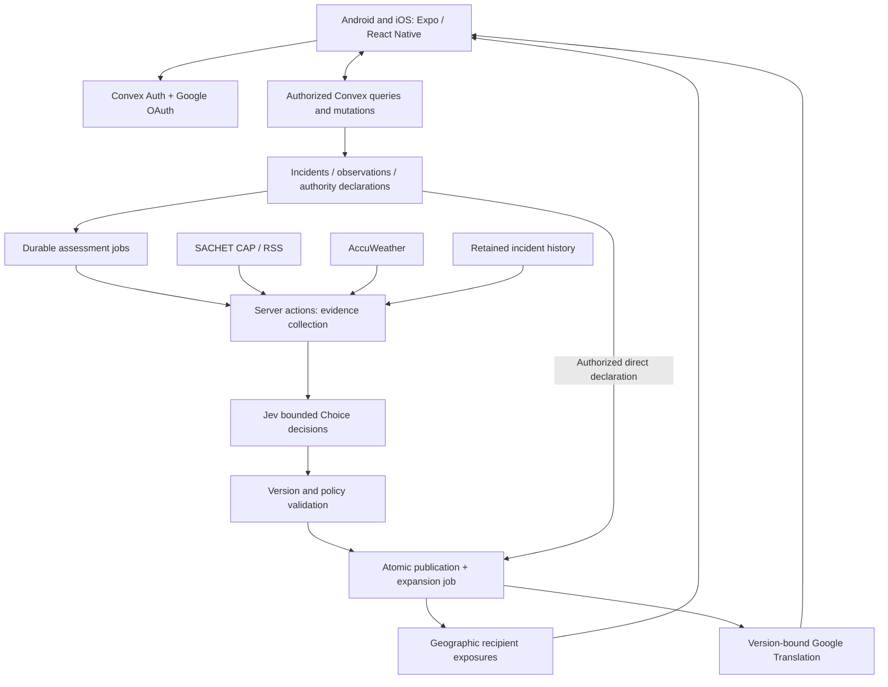

# GudTour — hackathon case study

**Local alerts. Your language.**  
Bits and Bytes CS Week · IIITDM Kancheepuram · TravelTech · 10 October 2026

**Website:** https://gudtour.zapdos.me  
**Demo recording:** `[PASTE_DEMO_VIDEO_URL_HERE]`  
**Final APK:** `[PASTE_PUBLIC_FINAL_APK_URL_HERE]`

This is the judge-facing explanation of the implementation and its decisions. It distinguishes implemented behavior, recorded build evidence, pending acceptance and future work. Earlier design documents contain proposals that were deliberately changed during development; this document uses the latest scope overrides.

## 1. The problem: useful information that does not reach the visitor

The selected statement is **“Real-Time Crisis Communication for Tourists During Extreme Weather Events.”** The [organizer brief](hackathon-brief.md#traveltech) identifies fragmented weather warnings, emergency broadcasts and safe-zone declarations, compounded by unfamiliar geography and language barriers.

Consider a tourist in an unfamiliar Indian city during intense rain. A forwarded message mentions a flooded road. An official notice uses a district name the visitor does not recognize. A shelter is listed elsewhere, but its last confirmation is unclear. The visitor needs to understand relevance and provenance before acting.

Four failures overlap:

| Failure | What the tourist needs |
| --- | --- |
| Geographic ambiguity | “Does this concern where I actually am?” |
| Unclear credibility | “Is this a witness report, an official instruction, or a model judgment?” |
| Language mismatch | “What does the instruction say, including what I must not do?” |
| Fragmented next steps | “Where can I read the original and find nearby shelter information?” |

GudTour brings these questions into one mobile workflow. It does not claim to forecast every hazard, authenticate the physical truth of every report, or certify a route as safe.

## 2. Our solution in one minute

A tourist selects a language, signs in, grants location access and enters a map-first app. They can inspect nearby incidents, report one of eight hazards, read SACHET notices, inspect listed shelters and use nearby community chat.

Reports enter as community observations. The backend builds recent, locally relevant evidence and asks Jev bounded questions. Eligible results can qualify an incident for publication; unavailable or stale results cannot silently become confirmed emergencies.

An approved authority uses a separate jurisdiction-bound workflow to declare an emergency immediately. This path does not depend on Jev, weather enrichment or a community voting threshold.

Published emergencies create durable targeting work. Eligible open clients receive a foreground alert with instructions, source, severity and nearest listed shelter information. Dynamic translations are attached to the exact instruction version, and the original remains accessible.

**The product is one Android/iOS application with a real backend, not a collection of disconnected mock screens.** The current distribution modes differ: a signed Android APK, an iOS simulator build for demonstration, and a public landing page.

## 3. Mapping the statement to working features

| Statement requirement | GudTour implementation | Important boundary |
| --- | --- | --- |
| Localized crisis information | Native map, hazard geometry, nearby incident views and geographic targeting | Approximate areas and missing geometry are not precise street-level truth. |
| Reduce dependence on rumors | Distinct observations, independence/recency checks, evidence snapshots and explicit provenance | Community/model-qualified does not mean government-verified. |
| Local authority communication | Approved memberships, jurisdiction checks, direct declaration and source-specific endings | Configured hackathon authority demonstrations are DEMO, not government partnerships. |
| Understandable translated instructions | Six UI language choices, dynamic Google Translation, original/source display | Machine translation is not certified official translation; human review remains pending. |
| Useful next information | Shelter records, status, confirmation time, distance and contact details | Nearest is straight-line proximity, not a verified safe route or available capacity. |
| Accessible mobile delivery | Shared native Android/iOS implementation, signed Android APK, iOS recording target | Public APK wiring and video link must be completed in the submission links. |

## 4. Complete user journeys

### Tourist: from arrival to awareness

1. Choose English, Hindi, Tamil, French, German or Spanish.
2. Complete mandatory foreground location admission inside India. Missing permission or an insufficiently accurate fix produces recovery instead of a fabricated location.
3. Complete Google sign-in and profile setup. Public displays use an alias rather than exposing the private profile.
4. Open Map. Navigate to Incidents, Shelters, SACHET, Nearby chat or Settings.
5. Inspect source/status information. A report being visible is not the same as an emergency being published.
6. Choose System, Light or Dark appearance; the preference is saved locally.

### Tourist: reporting an incident

The report flow offers flash flood, flood, landslide, cyclone, storm, coastal surge, heat and other hazards. It validates observation time, description and fresh location, and shows similar incidents before submission so the tourist can contribute to existing evidence.

Submissions are idempotent: a retried request must not create another independent witness. Repeat observations from the same person must not inflate corroboration. The normal tourist report flow remains a COMMUNITY observation even when the signed-in account also holds authority access.

### Authority: direct emergency communication

An approved authority opens its workspace, chooses the incident or declaration area, enters public instructions and reviews publication. Backend membership and jurisdiction checks determine permission; the screen itself is not an authorization boundary.

Declaration creates a source of emergency communication and schedules geographic expansion. Ending one authority source must not erase a different active source. Optional DEMO test-evidence notices are isolated tools: they provide controlled evidence for assessment but never directly publish an alert.

### Tourist: receiving and revisiting an alert

The global foreground controller presents the message across the application rather than requiring the tourist to watch a particular tab. The first message includes the actual instruction and issuer, not merely a button asking the user to read something elsewhere.

Dismissal controls presentation, not the underlying emergency. Persistent warning/detail surfaces retain access. Original instructions and translation state remain visible. Location relevance, stale information and source endings are separate concerns.

### Nearby chat

Authenticated users with eligible recent India locations can exchange short, alias-based messages within 15 km of the message origin. Messages expire after 24 hours. Sending is idempotent and bounded by burst/hour limits; messages are plain text without media, DMs or clickable links.

Chat is deliberately excluded from witness counts, Jev evidence and authority announcements. Moderation was excluded from the final hackathon chat scope, so this is not presented as a production-ready moderated community service.

## 5. Architecture and responsibility boundaries

### Mobile owns presentation; the backend owns trust

The client requests actions and renders read models. It does not assign itself an authority role, accept its own model decision, or choose which other users should receive an alert.

Convex queries return authorized, filtered data. Mutations atomically validate and change canonical records. Actions perform network calls. Scheduled jobs provide retries and resumable processing. This separation keeps provider latency out of atomic domain writes.

### Why version guards matter

An assessment can begin against incident revision A while an authority changes the incident to revision B. Applying the late answer to B would be a correctness bug even if the model returned a plausible result. Stored evidence/control revisions are checked again when results are applied.

Likewise, translation for an old instruction must not appear beneath a new instruction. Translation identity includes the original version/hash and target language. Asynchrony is part of the domain design, not only a loading spinner.

### Why durable targeting matters

Publication and its expansion job are committed together. The system does not rely on a fragile sequence of “save emergency, then hope a separate notification request succeeds.” Expansion is bounded and resumable, with deduplication and exact geographic checks after indexed candidate selection.

This implements foreground real-time communication through subscriptions. It is not an APNs/FCM closed-app notification service.

## 6. Technology choices and trade-offs

| Choice | Why it fit the problem and time budget | Trade-off we accepted |
| --- | --- | --- |
| Expo SDK 57 + React Native 0.86 + React 19 + TypeScript | Shared domain/UI work for two mobile platforms; native permissions, maps, fonts and build tooling | Shared source does not eliminate platform-specific testing or signing. |
| Expo Router | Explicit routes, onboarding transitions, details and authority screens | Startup/auth hydration must be coordinated to avoid wrong-screen flashes. |
| Convex | Reactive data, transactional mutations, scheduled functions and TypeScript contracts together | Use bounded geographic indexes plus exact checks; do not assume PostgreSQL/PostGIS behavior. |
| Convex Auth + Google OAuth | Established authentication and session lifecycle | Identity does not confer authority; callbacks differ by environment. |
| Apple Maps / Google Maps through react-native-maps | Platform-native basemaps with common app overlays | Different platform configuration; Android API key/signing restrictions and native readiness matter. |
| Turf + geohash | Efficient candidate selection followed by actual geometry validation | A geographic cell is a search aid, not final evidence of overlap. |
| NDMA SACHET CAP/RSS + fast-xml-parser | Source-attributed notices with message references and geography | Missing/failed geometry remains unknown; feed availability and notice validity are different clocks. |
| AccuWeather | Current and recent conditions support evidence assessment | Local weather cannot establish upstream flood conditions; missing context stays unknown. |
| Jev 1.13 through OpenCode Zen | Bounded typed choices suitable for explicit backend policy | Thresholds require evaluation; model confidence is not measured real-world hazard probability. |
| Google Cloud Translation Basic v2 | Dynamic translation of changing instructions | Preserve originals; critical semantics need more than simple entity matching. |
| i18next + react-i18next + expo-localization | UI strings work without a translation API call for each render | Six-language resources still need full human and layout review. |
| SecureStore | OS-backed storage for session/preferences | Local preferences do not replace fresh location admission. |
| Native system font / Inter / Lucide / SVG | Consistent readable hierarchy and a recognizable mobile interface | Real-device typography and accessibility need separate checks. |
| EAS/native build tooling | Standalone Android artifact and native iOS development build | A successful build is not a successful public distribution or device acceptance test. |
| Vitest + convex-test + React component tests | Fast domain, backend and interaction regressions | Passing tests do not validate model calibration or guarantee field reliability. |
| Static HTML/CSS/JavaScript landing | Small independent deployment and direct product/download access | Public release URLs must be explicitly supplied and checked. |

**Dependency disclosure:** [package.json](../package.json) and `package-lock.json` record the installed packages and exact resolved dependency graph. Expo notifications/SQLite/task-related dependencies may exist without their full originally planned feature being delivered. Runtime behavior, not package presence, defines the scope.

**AI-assisted development disclosure:** OpenCode and AI coding/research assistants supported planning, implementation, reviews and documentation; the team reported organizer permission for AI-agent use. Research delegation included DeepSeek V4.1 Flash. These development assistants are separate from Jev, the product’s bounded runtime decision model. No claim of exclusively hand-written implementation is made.

## 7. The decision model is deliberately bounded

The evidence pipeline combines recent independent observations, current/recent weather, geographically relevant SACHET notices and retained incident context. Unknown provider data is represented as unknown rather than a vote that conditions are safe.

Jev uses a two-stage Choice integration. Backend interpretation distinguishes notifiable emergency, not qualified and insufficient evidence. A selected notifiable outcome requires the configured **0.90** option-probability threshold and applicable backend checks. Overall confidence and option probability are distinct.

Important safeguards:

- Recent observations queue assessment; periodic reassessment is hourly.
- Transient failures retry on bounded schedules instead of producing an invented answer.
- Evidence and control versions are rechecked before applying a result.
- Authority declarations bypass assessment.
- A negative later result cannot automatically end an existing emergency.
- DEMO evidence cannot qualify LIVE incidents.
- The model does not generate evacuation instructions or fetch arbitrary sources itself.

Provider work is budgeted: the default reserves two calls per assessment within a 100-call daily deployment budget. A one-minute worker sweep resumes jobs; it is not a model call for every incident every minute. The recorded Jev v3 synthetic smoke check matched four of four cases; **that is a smoke test, not a held-out accuracy or calibration result**.

## 8. Official data, translation and freshness

### SACHET

Ingestion preserves source identity, originals, message lifecycle references, issue/expiry information and available geometry. Updates/cancellations must not be lost merely because a later feed is shorter. A broad official area is not relabeled as an exact street flood.

The latest polling policy is 30 minutes, with failure backoff up to six hours and a 45-minute feed-freshness policy. Individual source expiry remains independent. A failed request does not mean there are no notices. The SACHET browser and evidence adapter are implemented; complete automatic urgent-source-to-emergency fanout remains unfinished.

### Translation

Static UI resources cover six language choices. Dynamic instruction translation is backend work tied to the exact original. If translation fails or is unavailable, show the original and its status; do not substitute unrelated or predecessor instructions.

Place names, deadlines, numbers, prohibitions and instruction strength are particularly important. Entity checks alone cannot prove semantic fidelity; full human review is an explicit next step.

### Shelter relevance

Shelters carry issuer, status and confirmation timestamps. The current product intentionally uses **raw nearest listed shelter by straight-line distance**. It does not implement suitability filtering, capacity verification, hazard-avoiding routing or a safe-route guarantee. Authority instructions remain the primary information.

## 9. UI and cross-platform delivery

The interface starts with the map and a direct report action. Supporting views separate public incidents, shelters, official notices, community chat and settings. Emergency messages prioritize instructions in the first view.

The visual system uses warm neutral surfaces, charcoal controls, restrained pastel accents and hazard-specific semantic colors. Android uses bundled Inter; iOS uses system typography. System/Light/Dark preferences are persisted. Native map behavior and permission recovery are handled separately from visual styling.

Building for both platforms was a practical choice: tourists should not be restricted to a single phone ecosystem, and shared logic helps keep incident and authority behavior consistent. This is a strength of our delivery—not a claim about what other teams built.

The landing page lives entirely in `web/`. It has no app login or location collection, uses real development screenshots with simulated-data labels, and keeps unreleased downloads visibly pending rather than inventing links.

## 10. Testing and implementation evidence

Fresh check for this documentation: `npm run check` passed **308 tests in 54 files**, strict TypeScript and Expo lint on 10 October 2026.

| Concern | Representative evidence in the repository |
| --- | --- |
| Identity and authority isolation | `tests/backendIdentity.test.ts`, `tests/authorityAllowlist.test.ts`, `tests/authorityAreas.test.ts` |
| Reporting, independence and lifecycle | `tests/backendObservations.test.ts`, `tests/incidentState.test.ts`, `tests/reportTime.test.ts` |
| Direct declarations and DEMO isolation | `tests/declarations.test.ts`, `tests/demoNotices.test.ts` |
| Durable geographic expansion and ordering | `tests/alertExpansion.test.ts`, `tests/alertOrder.test.ts`, `tests/geography.test.ts` |
| Evidence, decisions and provider failures | `tests/evidence.test.ts`, `tests/assessments.test.ts`, `tests/jev.test.ts`, `tests/weather.test.ts` |
| CAP lifecycle/polling and translations | `tests/sachet.test.ts`, `tests/sachetPolling.test.ts`, `tests/googleTranslation.test.ts` |
| Chat isolation, location and UI behavior | `tests/backendChat.test.ts`, `tests/chatLocation.test.tsx`, `tests/chatUX.test.tsx` |
| Native regressions and startup | `tests/mapReadiness.test.tsx`, `tests/relativeTime.test.ts`, `tests/startup.test.tsx` |
| First-message information and shelters | `tests/emergencyAlerts.test.tsx`, `tests/nearestShelter.test.tsx`, `tests/shelterDetail.test.tsx` |

Two useful engineering lessons came from actual native failures: Google Maps needed readiness gating before padding/camera operations, and the native runtime lacked `Intl.RelativeTimeFormat`, requiring localized fallback formatting. Both have regression coverage. These are examples of moving beyond a web-only preview.

Recorded final APK checks include signing identity, ZIP integrity, launcher/splash assets, production-backend selection and absence of configured server credentials. The APK filename, source and checksum are in the [README](../README.md#verification-and-honest-scope).

Landing checks covered 320, 390, 768 and 1440-pixel layouts, image loading, overflow, keyboard skip-link behavior, reduced motion, URL validation and automated accessibility rules. Automated accessibility checks are not a full screen-reader or native device audit.

## 11. What is complete and what is not

| Status | Scope |
| --- | --- |
| Implemented and covered by repository checks | Core onboarding/auth, community reports, authority declarations, shelter management, in-app alert infrastructure, translation pipeline, SACHET ingestion/browser, weather/evidence/Jev workers, nearby chat, appearance preference. |
| Built / recorded artifact evidence | Final signed Android APK; native iOS simulator build. |
| Publicly reachable | Website at https://gudtour.zapdos.me. |
| Submission wiring still needed at this check | Website APK URL, direct final APK URL, demo recording URL/file. The live website still served a prior release-pending page. |
| Needs broader acceptance | Physical Android cold-start/relaunch, two-client targeting/chat, complete native accessibility and six-language review, model held-out evaluation. |
| Incomplete workflows | General incident/authority review controls, complete urgent SACHET fanout, comprehensive retention/deletion and durable recovery. |
| Explicitly deferred or excluded | Closed-app OS push, offline map downloads/routing, emergency contacts, shelter eligibility filtering, chat moderation and news ingestion. |

Some older status paragraphs mention earlier APK candidates, blue UI or placeholder chat. Those are dated history, not the latest feature state. The final artifact is versionCode 13 from source `8059adf`; documentation and landing commits after it do not automatically change that APK.

## 12. Judge walkthrough and video structure

Use a real 2–5 minute recording. Label controlled incidents and authority scope **DEMO**. Show Android and iOS explicitly, without implying that an iOS simulator recording is a TestFlight release.

| Time | Show | Explain |
| --- | --- | --- |
| 0:00–0:25 | Problem and app map | Fragmentation + language + location relevance. |
| 0:25–1:10 | Tourist report and existing-incident contribution | A witness observation is not an automatic emergency broadcast. |
| 1:10–1:50 | Evidence/context view | Show source timestamps and the bounded assessment result; distinguish model from authority. |
| 1:50–2:40 | Approved DEMO authority declaration → eligible open tourist client | Direct publication bypasses Jev; the first message contains useful instructions. |
| 2:40–3:15 | Translation/original + nearest listed shelter | Understandability and source visibility; distance is not safe routing. |
| 3:15–3:40 | Nearby chat and iOS interface | Two native platforms, shared workflow, separate community channel. |
| 3:40–4:15 | Android install/website and evidence summary | Real access, architecture and tests; name remaining limits. |

Before recording, ensure both clients use the same intended backend and DEMO scope. A development iOS client and production APK otherwise read different records. Never fabricate a successful cross-device delivery by editing together unrelated events. If a step cannot be demonstrated, identify it rather than calling it verified.

## 13. How the work addresses the rubric

| Criterion | What judges can inspect |
| --- | --- |
| Innovation — 20% | Connected tourist-specific communication, explicit provenance, independent authority/model paths and version-bound multilingual instructions. |
| Technical implementation — 35% | Native clients, reactive backend, atomic publication, durable jobs, identity/jurisdiction checks, geographic targeting, provider adapters and 308 tests. |
| Feasibility — 20% | Bounded model work, caching, separate environments, budget controls, explicit current limitations and an actionable completion path. |
| Video — 15% | Real end-to-end demonstrations, both mobile platforms and a clear explanation of why each transition matters. Recording link pending. |
| Deployment — 10% | Signed Android artifact, public website and iOS demonstration build. Final public APK wiring must be completed. |

These are evidence pointers, not a prediction of scores or a claim of guaranteed success.

## 14. Reproduction, credits and next steps

Follow the [README setup](../README.md#run-locally) and [provider setup guide](api-setup.md). Use your own development environment, OAuth callbacks, Maps restrictions and backend provider credentials. Authority permissions must be configured server-side; normal sign-in never grants them.

We use third-party maps/data/model/translation services with attribution and their respective terms. Inter is by Rasmus Andersson under SIL OFL 1.1; the dependency includes its font license. The Android brand asset on the landing page includes its required Google/Creative Commons attribution. SACHET integration does not imply NDMA endorsement or partnership, and public DEMO authority tools do not represent a real government deployment.

Next engineering priorities are physical two-client acceptance, final public download verification, human language review, held-out model evaluation, remaining incident/authority management and privacy/recovery workflows. Closed-app push and offline capability require a deliberate later delivery phase.

**The core result:** GudTour makes a difficult chain of responsibilities explicit—from someone observing a hazard to a nearby tourist reading an attributable instruction in their language. We built that chain across a native Android/iOS application and a real backend, and documented the points where evidence ends and further validation begins.
